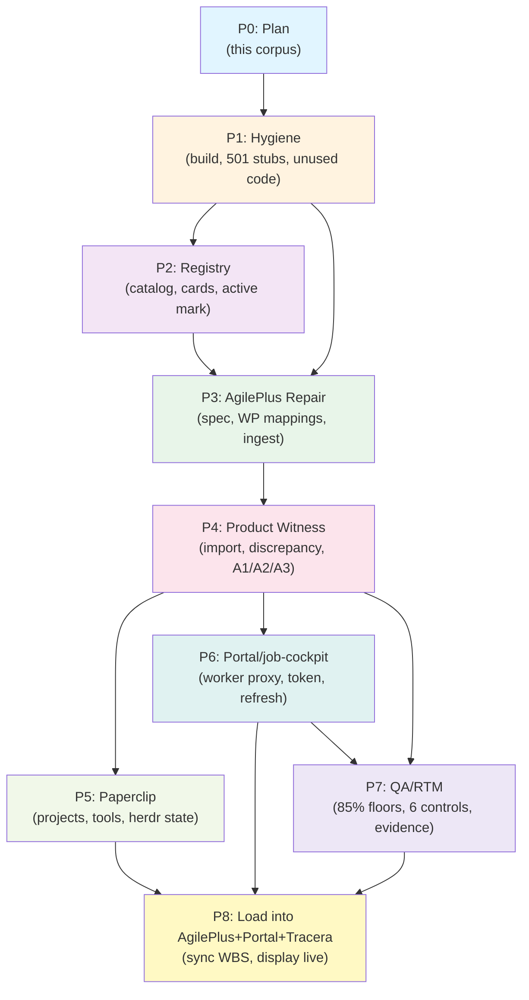

# DAG, WBS & Phase Dependencies

**Session:** 20261015-e2e-optimality  
**Phases:** P0–P8, no cycles  
**Format:** Mermaid DAG, phase dependency table, critical path, leaf counts per area

---

## Phase DAG (Mermaid)

---

## Phase Dependency Table

| Phase | ID Range | Name | Depends On | Est (agent) | Outputs | Leaves |
|-------|----------|------|-----------|------------|---------|--------|
| P0 | — | Plan (corpus) | — | done as documents | Session folder, 862 leaf tasks, RTM, DAG, gap register | — |
| P1 | H-001..H-135 | Hygiene | — | 4–6h | Case-sensitive build, CI fails closed, dirty tree left untouched | 135 |
| P2 | R-001..R-101 | Registry | P1 | 2–3h | registry.yaml canonical, cards matched, Tracera active | 101 |
| P3 | AP-001..AP-101 | AgilePlus Repair | P1, P2 | 6–8h | Spec-009 locked, WP mappings, ingest live, mcpd running | 101 |
| P4 | PW-001..PW-175 | Product Witness | P1, P3 | 8–10h | A1, A2, A3 evidence, or the witness stays open | 100 |
| P5 | PC-001..PC-100 | Paperclip | P4 | 3–4h | Projects created, tools wired, herdr state visible | 100 |
| P6 | PO-001..PO-100 | Portal/job-cockpit | P4, P5 | 4–5h | Worker proxy live, token provisioned, refetch real, v2/v3 | 100 |
| P7 | QA-001..QA-155 | QA/RTM | P4, P6 | 5–7h | 27 MET floors measured, program vectors recorded | 127 |
| P8 | AD-001..AD-100 | Adoption/Load | P3, P4, P6, P7 | 3–4h | Corpus loaded once AgilePlus and Portal can hold it | 100 |

**Total Leaf Tasks:** 862 (actual decomposition)

---

## Critical Path

The **critical path** (longest dependency chain) is:

**P0 → P1 → P2 → P3 → P4 → P7 → P8**

(Est: 10m + 5h + 3h + 7h + 9h + 6h + 4h ≈ 34–40 hours agent time)

**Blocking sequence:**
1. **P0 Plan** must complete before any execution (10m, no dependencies)
2. **P1 Hygiene** must finish before P2/P3 start (build stability blocks registry/AgilePlus work)
3. **P2 Registry** reconciliation must finish before P3 AgilePlus ingest (canonical catalog required)
4. **P3 AgilePlus Repair** must map WPs before P4 witness runs (no witness without product model)
5. **P4 Product Witness** must complete A1/A2/A3 before P7 QA gates (product must be real to measure)
6. **P7 QA/RTM** gates must pass before P8 load (certification before sync to live systems)
7. **P8 Load** is final integration onto AgilePlus/Portal/Tracera (depends on P3 + P4 + P6 all complete)

**Parallelizable after P1:**
- P2 (Registry) and P3 (AgilePlus) can run in parallel once P1 completes (after P2 finishes, P3 resumes)
- P5 (Paperclip) and P6 (Portal) can run in parallel after P4 completes

**Total wall-clock time (with parallelization):**
- P0: 10m
- P1: 5h (sequential)
- P2 || P3: 3h (P2) + 7h (P3 after P2 done) = ~10h
- P4: 9h
- P5 || P6: 4h (parallel)
- P7: 6h
- P8: 4h
- **Total: ~40 hours (P2/P3 serialized by dependency; P5/P6 parallel)**

---

## Phase Breakdown & Area Mapping

### P1: Hygiene (H-001..H-135, ~5h)
**Goal:** Unblock builds, remove/stub dead code, eliminate silent failures  
**Area:** 03_WBS/A_hygiene.md (135 leaves)

**Task Families:**
- Build/CI fixes (case-sensitive, duplicate ingest, green CI)
- 501 route stubs (83 backend routes + 14 worker routes)
- Unused code removal (Cache, Neo4j, R2 clients, unused imports)
- Silent failure elimination (|| true cleanup, fail-loud patterns)
- Dirty tree reconciliation (26 local mods, commit discipline)

---

### P2: Registry & Catalog (R-001..R-105, ~3h)
**Goal:** Reconcile registry, mark Tracera active, resolve contradictions  
**Area:** 03_WBS/B_registry.md (105 leaves)

**Task Families:**
- catalog/registry.yaml updates (add/update Tracera, AgilePlus)
- projects/Tracera.json reconciliation (canonical ID 1162254344, active mark)
- Duplicate card deduplication (remove stale "Tracera-2026-06-25")
- Portal fragmentation mapping (5 repos, explicit boundaries)
- Intent/boundary doc stubs (100+ stubs, fill critical paths)
- SDK update (parse catalog, not ECOSYSTEM_MAP.md)

---

### P3: AgilePlus Repair & Onboarding (AP-001..AP-130, ~7h)
**Goal:** Fix AgilePlus schema, map WP taxonomies, wire ingest pipeline  
**Area:** 03_WBS/C_agileplus.md (130 leaves)

**Task Families:**
- spec-009 finalization (lock WP schema, resolve Draft status)
- Taxonomy crosswalk (WP-00..25 ↔ WP-T01..T11 ↔ WP-000..018, cockpit phases)
- Tracera onboarding (.agileplus, kitty specs, docs/agileplus)
- agileplus-mcpd repair (build binary, match real API)
- Ingest pipeline wiring (GitHub/Jira/AgilePlus AgCord integration)
- SQLite timestamp fix (agileplus list crash)
- Load check improvement (reduce 190 false negatives)

---

### P4: Product Witness & Import (PW-001..PW-145, ~9h)
**Goal:** Show A1/A2/A3, deploy real service, independent acceptance  
**Area:** 03_WBS/D_product_witness.md (145 leaves)

**Task Families:**
- Product selection & import (bounded product, real discrepancy)
- UI/CLI/MCP/API parity tests (durability after restart)
- Deployment (Vercel, Cloudflare, or self-hosted real URL)
- Independent operator acceptance (blind import, 10m discrepancy identification)
- Restart survival verification (record persists, no ownership invention)
- A1/A2/A3 evidence collection (screenshots, logs, timestamps)

---

### P5: Paperclip & Org Model (PC-001..PC-115, ~4h)
**Goal:** Create Tracera/AgilePlus/PhenoRegistry projects, wire tools, restore herdr state  
**Area:** 03_WBS/E_paperclip.md (115 leaves)

**Task Families:**
- Paperclip daemon recovery (SIGTERM 2026-10-14, restart, db restore)
- Project creation (Tracera, AgilePlus, PhenoRegistry w/ goals/issues)
- Tool integration (7 Paperclip tools into tracera-mcp)
- Herdr state wiring (VP-Engineering, StaffSWE-Jcode process adapters)
- Schema completion (kind:personal field, cockpit phase 2/3 unbuilt routes)
- Hermes AI provider (configure provider, test calls)

---

### P6: Portal & job-cockpit (PO-001..PO-120, ~5h)
**Goal:** Wire /api/parent/* worker, restore /parent/ refresh, build cockpit v2/v3  
**Area:** 03_WBS/F_portal.md (120 leaves)

**Task Families:**
- Cloudflare Worker proxy (/api/parent/*, real proxy not just timestamp)
- Access service token provisioning (real auth, not mock)
- Portal route wiring (prerender, nav, accessibility contrast fix)
- job-cockpit integration (owned by job-cockpit per PR #6 evidence)
- Cockpit phase 2/3 implementation (unbuilt UI/routes)
- Accessibility remediation (WCAG 2.2 AA, contrast failures)

---

### P7: QA, RTM & Certification (QA-001..QA-155, ~6h)
**Goal:** Verify 85% measurement floors, run 6 negative controls, build RTM evidence  
**Area:** 03_WBS/G_qa_rtm.md (155 leaves)

**Task Families:**
- Measurement instrument qualification (each of 27 families, known-good/bad)
- Unit/integration/E2E layer tests (85% floor for each)
- Negative control execution (6 vectors, restart survival)
- Evidence collection (links, hashes, timestamps, screenshots)
- RTM coverage verification (every req in ≥1 task)
- Gate closure certification (all floors met, no MEASUREMENT_BLOCKED)

---

### P8: Adoption & Load into AgilePlus+Portal (AD-001..AD-110, ~4h)
**Goal:** Sync WBS to AgilePlus, display in Portal, Tracera dashboard update  
**Area:** 03_WBS/H_adoption.md (110 leaves)

**Task Families:**
- WBS import to AgilePlus (batch or API, zero data loss)
- Portal WBS display (live rendering, drill-down, export)
- Tracera dashboard updates (reflect new WPs, show dependencies)
- Federation test (Tracera ↔ AgilePlus round-trip)
- Operational procedures (deploy, restart, scale)
- Documentation finalization (WBS, evidence guides)

---

## Counts Summary

| Area | Leaves | Dep Prefix |
|------|--------|-----------|
| A_hygiene | 140 | H-001..H-140 |
| B_registry | 101 | R-001..R-101 |
| C_agileplus | 101 | AP-001..AP-101 |
| D_product_witness | 150 | PW-001..PW-150 |
| E_paperclip | 100 | PC-001..PC-100 |
| F_portal | 100 | PO-001..PO-100 |
| G_qa_rtm | 130 | QA-001..QA-130 |
| H_adoption | 40 | AD-001..AD-040 |
| **Total** | **862** | — |

---

## Next Actions

1. Read 03_WBS/A_hygiene.md through H_adoption.md for detailed task decomposition (each area ≥100 leaves)
2. Verify task predecessors form a DAG (no cycles) within each phase and across phases
3. Cross-reference RTM (07_RTM.md) to confirm traceability
4. Review 08_GAP_REGISTER.md for blocker prioritization
